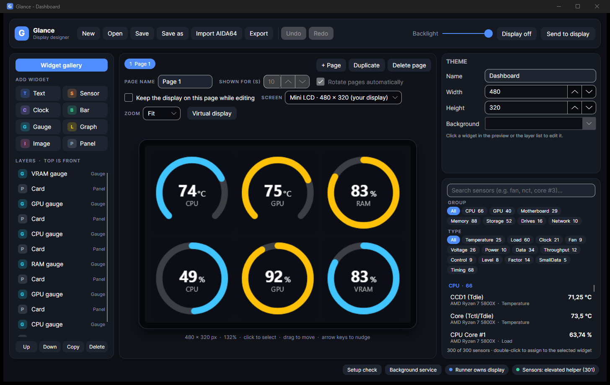

# Glance

A modern, open replacement for AIDA64's LCD customizer, for small USB displays that use the AX206-style protocol
(USB ID `1908:0102`, 480×320). Design your own screens with live hardware data, backgrounds, gauges, graphs and pages,
and keep them on the display from a small background app.

> Status: early. Windows first. New here? Read the [tutorial](docs/TUTORIAL.md) (with screenshots).



## What it does

- **Editor** (Avalonia): live preview, drag and resize, undo/redo, pages, premade widgets, a virtual display for demos without the hardware.
- **Widgets**: text, sensor values, clock, bars, gauges, history graphs, images, GIFs, video (needs FFmpeg), panels. Colour thresholds.
- **Sensors**: everything LibreHardwareMonitor can read (CPU, GPU, motherboard, fans, voltages, drives), plus drive space. Searchable by group and type.
- **Starter themes and premade widgets**: five ready-made themes (minimal, dashboard, gaming, a two-page overview, desk clock) and a gallery of about 30 cards, gauges, rings and graphs that bind to your own sensors.
- **AIDA64 import**: loads `.axlcd` themes with a preview, maps their items to your sensors.
- **Sharing**: export a theme as one `.glance` file (images and videos included) and open it on another PC.
- **Tray app**: shows your theme on the display without the editor, rotates pages, reloads when you save, blanks the screen on exit.
- **Glance service** (Windows service): owns the display and reads all sensors, also before anyone signs in; turns the display
  off when Windows shuts down or sleeps. It never opens your themes: your own tray app or editor draws them and sends finished frames.

## Requirements

- Windows 10/11, .NET 8 SDK
- The display must use the **libusb-win32** driver (install it with [Zadig](https://zadig.akeo.ie/), choose `libusb-win32`)
- [PawnIO](https://pawnio.eu/) for CPU and motherboard sensors (LibreHardwareMonitor needs it)
- Optional: FFmpeg for video backgrounds. A per-user install is enough (**Install FFmpeg** in Setup check, or
  `winget install Gyan.FFmpeg`): video is decoded by your own tray app and editor, never by the service.

## Install

Use the installer (`Glance-Setup-<version>.exe`). It puts Glance in Program Files, installs the **Glance service** (it starts with
Windows and is the only part with administrator rights) and starts the tray app when you sign in. Upgrading from 0.1 closes the old
elevated runner and removes its "start at sign-in" task.

The zip (`Glance-<version>-win-x64.zip`, no .NET needed) is a portable copy without the service: unzip it and run `Glance.App.exe` or
`Glance.Runner.exe`. Both run with your normal rights and drive the display directly, with the basic sensors only (no CPU temperatures,
fans or voltages). Glance no longer has an elevated mode.

## Build and run

```powershell
cd src
dotnet build Glance.sln -c Release
```

Run `Glance.Runner` (the tray app) and `Glance.App` (the editor) from their `bin\Release` folders. Without the service they use the
basic sensors. `Glance.Service.exe --console` runs the service code in a console (from an elevated prompt) for development; the
installer is the normal way to set it up.

## Tests

```powershell
dotnet test src/Glance.Tests -c Release
```

About 620 unit tests cover the logic that does not need the display or an installed service. They also run on GitHub for every push.

## Package and installer

```powershell
.\build\publish.ps1                      # dist\Glance and a self-contained zip (~215 MB folder, ~90 MB zip)
.\build\publish.ps1 -FrameworkDependent  # much smaller; needs the .NET 8 Desktop Runtime on the target PC
.\build\make-installer.ps1               # dist\Glance-Setup-<version>.exe (needs Inno Setup 6)
```

Bump the version in `src/Directory.Build.props` for a release. The editor, the tray app and the service live side by side in one
folder and find each other there.

## Layout

| Folder | Purpose |
|---|---|
| `src/Glance.Core` | Display driver, renderer, themes, sensors, presets, importer, service rules |
| `src/Glance.App` | Avalonia editor |
| `src/Glance.Runner` | Tray app (normal user rights): draws your theme and sends it to the service |
| `src/Glance.Service` | Windows service (LocalSystem): owns the display, reads the sensors |
| `src/Glance.Tests` | Unit tests |
| `src/UsbProbe` | Small diagnostic tool for the USB protocol |
| `build/` | Publish and installer scripts |
| `installer/` | Inno Setup definition |
| `assets/` | Application icon |
| `docs/PROTOCOL.md` | The display's USB protocol, reverse-engineered from a capture |
| `AGENTS.md` | Notes for AI coding agents working on this repo |
