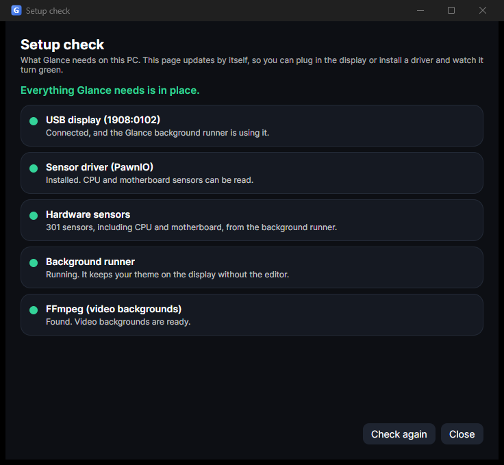
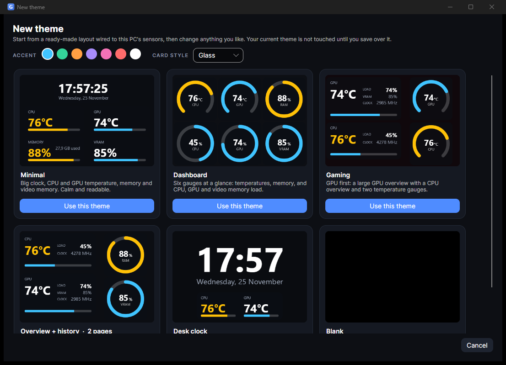
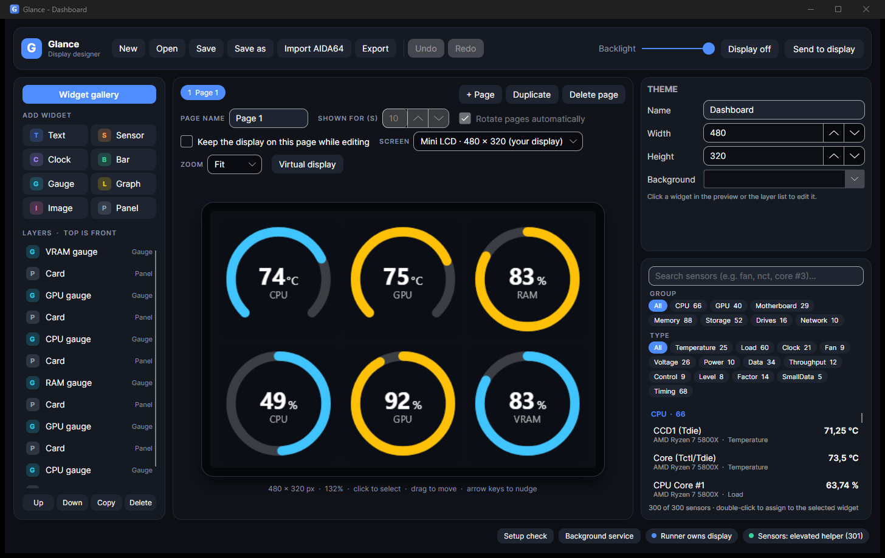
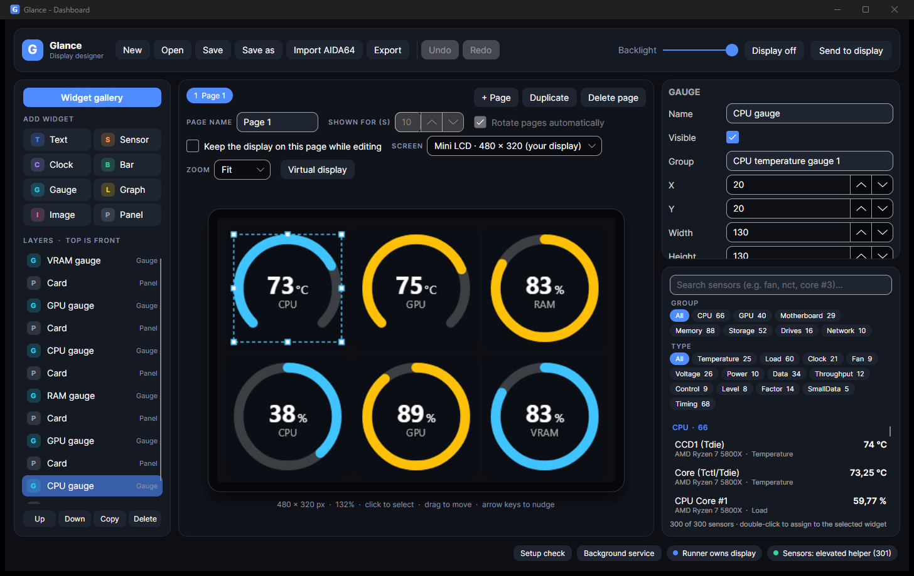
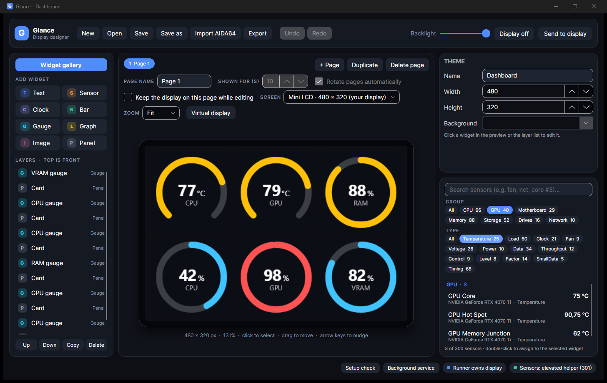
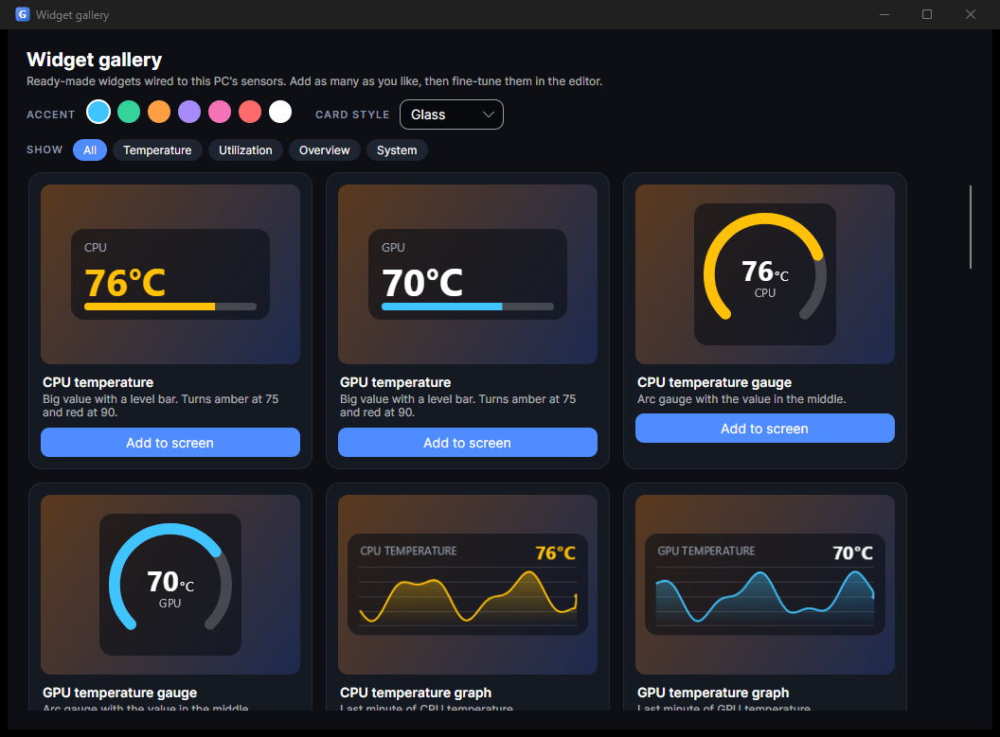
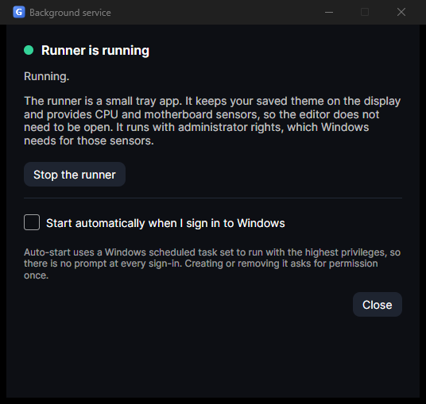
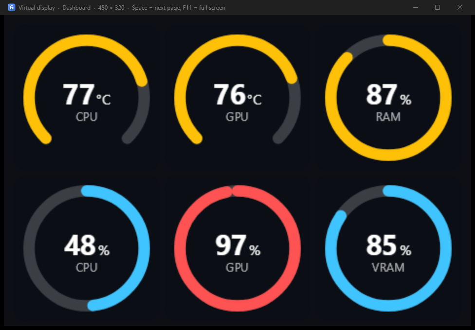

# Glance tutorial

A walk through the basics: get a screen onto the display, change it, and keep it running. Everything here
works with the real display, and most of it also works without one (see [Virtual display](#9-try-it-without-the-display)).

Glance has three parts that work together:

- **The editor** (`Glance.App.exe`): where you design themes. It runs with your normal rights.
- **The tray app** (`Glance.Runner.exe`): keeps your saved theme on screen when the editor is closed. It draws the theme with your
  normal rights and starts when you sign in.
- **The Glance service** (installed by the installer): a Windows service that owns the display and reads your hardware sensors.
  It is the only part with administrator rights, because Windows only lets administrators read CPU and motherboard sensors.
  It never opens your themes or files; the tray app and the editor send it finished pictures.

A portable copy (the zip) has no service: the tray app and the editor then drive the display directly, with the basic sensors only.

## 1. First start and the setup check

Start `Glance.App.exe`. On the first start (or any time from the **Setup check** button in the bottom bar) Glance checks what it needs:

| Item | What it means if it is not green |
|---|---|
| USB display | The display is not plugged in, uses another driver (it needs **libusb-win32**, install it with [Zadig](https://zadig.akeo.ie/)), or another program (AIDA64) is holding it. |
| Sensor driver (PawnIO) | CPU and motherboard sensors cannot be read until [PawnIO](https://pawnio.eu/) is installed. |
| Hardware sensors | The Glance service is not running (or not installed), so only basic sensors are available (CPU temperature may show 0 °C). |
| Glance service | Stopped, not installed (portable copy), or running without the tray app; see [step 8](#8-keep-it-running-without-the-editor). |
| FFmpeg | Only needed for video backgrounds. GIFs and images work without it. **Install FFmpeg** installs it for your user; no prompt needed. |

The page updates by itself, so you can plug in the display or install a driver and watch the dot turn green.

## 2. Start from a theme

Click **New** to pick a starter theme. They are wired to the sensors found on *your* PC.

Pick an accent colour and card style at the top, then **Use this theme**. Your current theme is not touched until you save over it.

## 3. The editor at a glance

- **Left**: widget buttons (Text, Sensor, Clock, Bar, Gauge, Graph, Image, Panel), the **Widget gallery**, and the layer list (top of the list is the front).
- **Middle**: pages and the live preview of the display. This is exactly what the display will show.
- **Right**: theme settings (or the properties of the selected widget) and the sensor list.
- **Top bar**: New, Open, Save, Save as, Import AIDA64, Export, Undo/Redo, backlight, **Display off** and **Send to display**.
- **Bottom bar**: Setup check, Background service, and whether the tray app shows your theme and where sensors come from.

The window can be made smaller; the top and bottom bars wrap and the right column scrolls.

## 4. Select, move, resize and edit

- Click a widget in the preview or in the layer list to select it. Drag it to move, drag a handle to resize, arrow keys nudge it.
- The right panel shows its properties: position and size, font, colours, the sensor it shows, and for bars and gauges the min and max.
- **Fonts**: pick any installed font from the **Font** list, with **Bold** and **Italic**. To use a font that is not installed, click **Use a font file...** and choose a `.ttf`, `.otf` or `.ttc`.
  The font file is copied into the theme's `assets` folder when you save and goes into `.glance` exports, so the theme looks the same on another PC. Clear the **Font file** box to go back to the installed font.
  Bold and italic on a font file are simulated, so for a real bold style pick that style's own font file.
- **Thresholds** change the colour with the value (for example amber at 75 and red at 90 for temperatures).
- Widgets that came from the same preset share a **Group**. A group moves together and is **resized together**: select any part and a yellow outline with handles appears around the whole group; dragging a handle scales every part (text and thickness included, hold **Shift** to keep the shape). Hold **Alt** while dragging to move just one piece.
- **Make your own group**: Ctrl+click or Shift+click several layers in the layer list, then click **Group**. **Ungroup** splits a group again.
- **Undo/Redo** (Ctrl+Z / Ctrl+Y) cover everything, including page changes.
- **Up / Down / Copy / Delete** under the layer list reorder, duplicate and remove widgets.

## 5. Choose a sensor

Select a widget that shows a value, then find its sensor in the list at the bottom right. There are a few hundred sensors, so use the filters:

- **Group** chips (CPU, GPU, Motherboard, Memory, Storage, Drives, Network) and **Type** chips (Temperature, Load, Clock, Fan, ...) narrow the list; the numbers are how many sensors each has on your PC.
- The search box matches names and hardware (try `fan`, `nct`, `core #3`).
- **Double-click** a sensor to assign it to the selected widget. The list shows live values.

## 6. Add premade widgets

**Widget gallery** has ready-made cards, gauges, rings and graphs for temperatures, utilization and system info.

Pick an accent and card style, filter by category, then **Add to screen**. The widgets are bound to your sensors and added as a group you can then move or restyle.

## 7. Backgrounds, pages and sending to the display

- **Background**: in the theme settings, choose an image, a **GIF** or a **video** (video needs FFmpeg). Fit and opacity are adjustable.
  The display can only update about 2.5 times a second, so full-screen video is choppy; GIFs and small animations look better.
- **Pages**: **+ Page** adds another screen. Each page has a **Shown for (s)** time and, with **Rotate pages automatically** on, the display cycles through them.
  **Keep the display on this page while editing** pins the display to the page you are working on.
- **Send to display** shows your current (even unsaved) theme on the real display. **Backlight** sets the brightness and **Display off** turns the screen black.
- **Save** writes the theme to your Glance folder; the tray app picks up saved changes by itself.

## 8. Keep it running without the editor

Click **Background service** in the bottom bar:

(The screenshot shows the earlier version of this window.)

- **Glance service**: whether it runs, and what the display is doing. **Start the service** needs no prompt; **Stop the service**
  asks Windows for permission, because stopping it turns the display and sensors off for whoever is at the PC.
- **Tray app**: keeps your saved theme on the display, even with the editor closed. The installer sets it to start when you sign in
  (turn that off in Task Manager > Startup apps). **Start the tray app** / **Stop the tray app** do it now.
- When the tray app exits or pauses, the display turns black. The service also turns the display off when Windows shuts down,
  restarts or goes to sleep, and when you sign out; your theme comes back after the PC wakes up.
- If Glance 0.1's "start at sign-in" task is still set up, the window offers to remove it.
- On a PC with several users, the display shows the theme of the person at the screen (the console session).
  Before anyone signs in the display stays dark.

## 9. Try it without the display

**Virtual display** (in the preview toolbar) opens a window that shows the theme exactly as the display would, with live sensors. Space switches page, F11 goes full screen.
You can also pick another screen size in the **Screen** menu, which is handy for demos.

## 10. Import, export and share

- **Import AIDA64** reads an `.axlcd` theme, shows a preview of the result and what was mapped, and only then imports it. Unknown items are skipped and listed.
- **Export** packs a theme with its images and videos into a single `.glance` file. **Open** a `.glance` file on another PC to get the same theme. You can also pass a `.glance` or `theme.json` path to `Glance.App.exe` to open it directly.

## Troubleshooting

- **The display stays black or shows nothing**: check the Setup check. Close AIDA64 (only one program can use the display) and make sure the driver is libusb-win32.
- **The display stays lit after shutting down the PC**: the Glance service turns it off when Windows shuts down, restarts, signs out or
  sleeps, and the tray app (or the editor, while it is sending) does too. If it is still lit, check the service log,
  `%ProgramData%\Glance\service.log`, for a line like `Windows SessionEnding: BlankAndStop`, and `runner.log` in your Glance folder
  (the tray app's log). Some PCs keep USB powered when off; turning that off in the BIOS/UEFI also works. Locking the PC or letting
  the monitor turn off does not turn the display off, and on laptops with Modern Standby it can stay lit for a while after the screen
  goes dark, until Windows really goes to sleep.
- **The display stays black after the PC wakes up**: the tray app reopens it within a few seconds, and on its own after about 30 s even if
  Windows did not report the wake-up. To bring it back at once, use **Reload theme** or **Resume display** in the tray menu. If the display
  itself did not come back, unplug and replug it. The editor (when it sends without the tray app) keeps trying for about a minute.
- **The tray menu says "Another user is at the console"**: on a PC with several signed-in users, only the person at the screen
  (the console session) can use the display. Switch back to your session and it shows your theme again.
- **CPU temperature is 0 °C or sensors are missing**: the Glance service is not running (or this is a portable copy without it), or PawnIO
  is not installed. Start the service from **Background service**, or install Glance with the installer.
- **AIDA64 cannot open the display**: pause or stop the Glance tray app (and close the editor's **Send to display**). The service lets
  go of the display about 20 seconds after it stops receiving pictures.
- **Updates look slow**: the display accepts about 2.5 full frames per second, so fast animation is not possible. Glance skips frames that did not change.
- **Colours look wrong**: report it with your display model; Glance sends RGB565 big-endian frames, which this display family expects.
- **Things overlap in a small window**: make the window a bit larger, or use the scrollbar in the right column. The minimum width is 1280 px.
